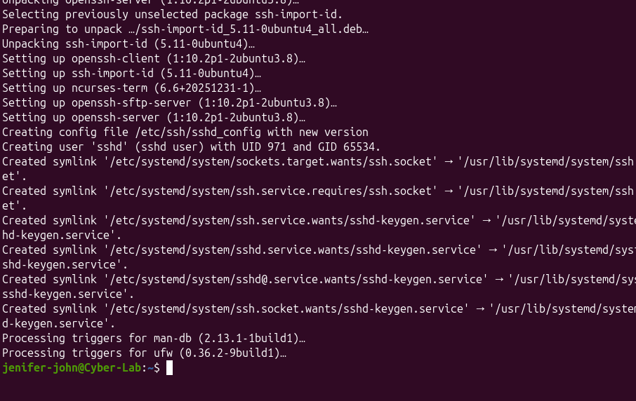

# SSH Authentication Monitoring and Failed Login Investigation

**Project type:** Personal SOC home lab
**Environment:** Ubuntu 26.04 LTS in Oracle VirtualBox
**Status:** Stage 1 completed

## Objective
To learn how SSH login activity can be monitored and investigated on Linux, by generating failed logins on purpose, finding them in the system logs, counting them, and identifying where they came from.

## Lab environment
- Operating system: Ubuntu 26.04 LTS (VirtualBox virtual machine, hostname Cyber-Lab)
- Service investigated: OpenSSH server, port 22
- Lab account: jenifer-john

## Step 1: Install the SSH server
```
sudo apt install openssh-server
```



## Step 2: Check the SSH socket and service
The socket was active and listening. Before any connection, the service showed inactive, because on Ubuntu the socket starts the service on demand.
```
sudo systemctl status ssh.socket
sudo systemctl status ssh
```


After I connected over SSH, the service started automatically and showed active (running). The log recorded my accepted login seconds later.


## Step 3: Confirm port 22 is listening
```
sudo ss -ltnp | grep ':22'
```
SSH was listening on port 22 for both IPv4 and IPv6.


## Step 4: Test a successful local login
```
ssh jenifer-john@localhost
echo "$SSH_CONNECTION"
```
The connection details were `127.0.0.1 39612 127.0.0.1 22`, meaning the connection came from the local machine.


## Step 5: Generate failed logins on purpose
I left the session and tried to log in again, forcing password login and typing the wrong password three times.
```
exit
ssh -o preferredAuthentications=password -o pubkeyAuthentication=no jenifer-john@localhost
```
SSH replied "Permission denied" after the third wrong password.


## Step 6: Investigate the authentication logs
I searched the SSH log for authentication events.
```
sudo journalctl -u ssh.service --no-pager | grep -iE 'faild|invalid|authentication|accepted|password'
```
The results showed the accepted login, the failed password checks, and PAM authentication failures.


## Step 7: Count and list the failed attempts
```
sudo journalctl --since "2 hour ago" --no-pager | grep -Fc "Failed password"
sudo journalctl --since "2 hour ago" --no-pager | grep "Failed password"
```
The count was 3, matching my three deliberate attempts.


## Step 8: Extract the source IP address
```
sudo journalctl --since "2 hour ago" --no-pager | grep "Failed password" | awk '{print $(NF-3)}'
```
All three records came from 127.0.0.1.


## Findings

| Item | Result |
| --- | --- |
| SSH socket | Active and listening on port 22 |
| SSH service | Starts on demand, then active (running) |
| Successful login | Accepted password for jenifer-john at 18:10:46 |
| Failed logins | 3 (19:28:15, 19:28:44, 19:29:07) |
| Account targeted | jenifer-john |
| Source IP | 127.0.0.1 (localhost) |

## Analysis
- 127.0.0.1 is the loopback address, so the failures came from the same machine, not an outside attacker. This matches what I did on purpose.
- All three failures came from one connection (source port 36156) within about a minute.
- The accepted login used port 39612, which matches the connection details I checked earlier, so the logs line up with my actions.
- The system also had 412 pending updates, 279 of them security updates. On a real server, I would patch these.
- In a real SOC, I would worry about many failures from one external IP, attempts on many usernames, or failures followed by a success. This lab showed none of those.

## Skills practised
- Linux command line basics
- Installing and checking the SSH service
- Checking listening ports
- Reading authentication logs with journalctl
- Filtering and counting log entries with grep
- Extracting fields with awk
- Writing up investigation findings
